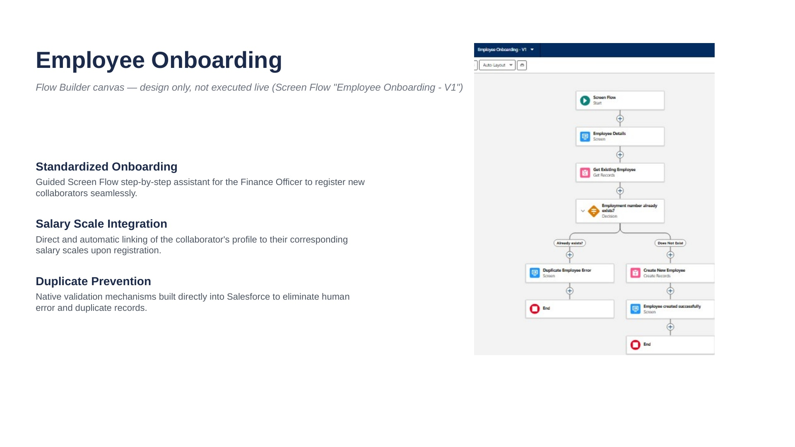
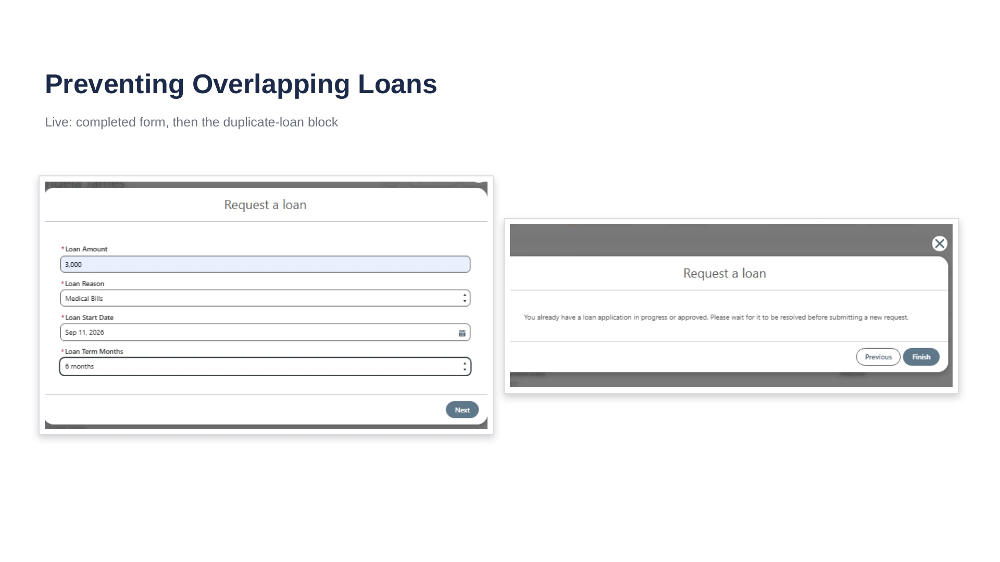
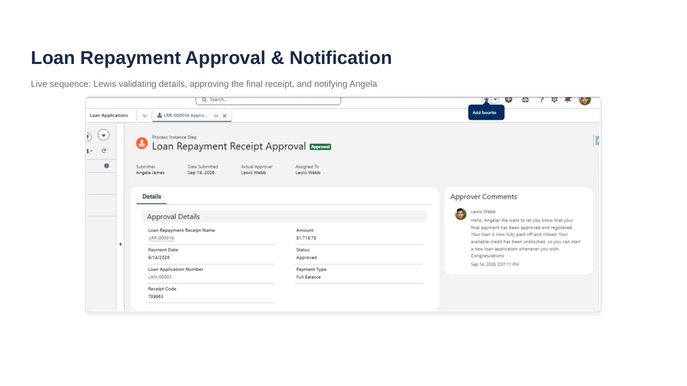
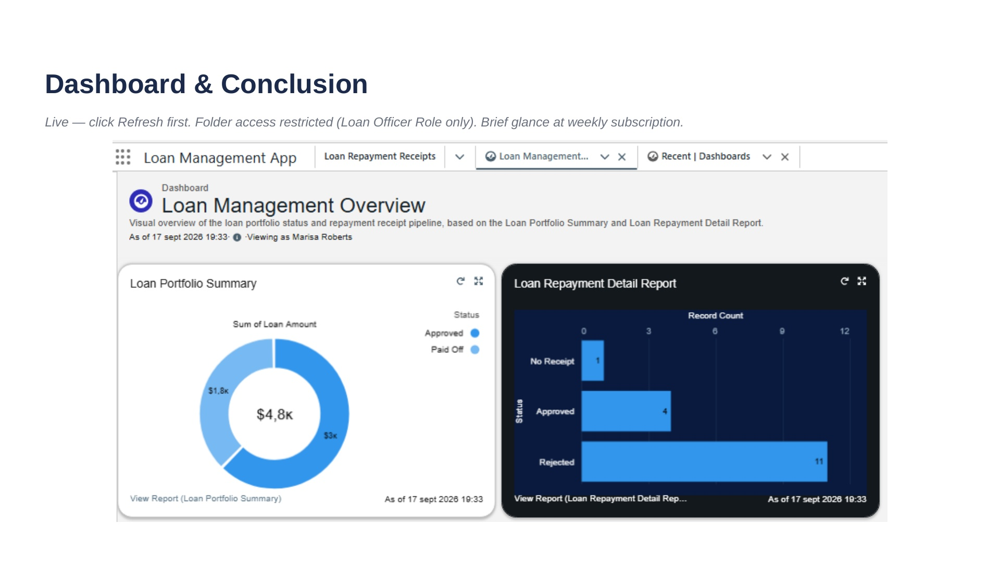

# Loan Management App — Salesforce Business Process Automation

End-to-end employee loan management for a fictional company (Pure Truth Water Factory), built on Salesforce with a fully declarative approach: Flows, subflows and Approval Processes.

**Tools & concepts:** Flow Builder (Screen, Autolaunched and Record-Triggered Flows) · Approval Processes · Formula and Roll-Up Summary fields · Reports & Dashboards · Field-Level Security · Sharing and System Context

**Author:** Marisa E. Roberts · **Project:** Project Presentation — Dev. Foundation Phase (Africa Ohana)

🎬 **Demo video:** <a href="https://drive.google.com/drive/folders/1ZqcQVPsFK7mmCRHI2Z2y9addrnkbzAnD?usp=sharing" target="_blank">Watch Video Demo on Google Drive</a>

💼 **LinkedIn post:** <a href="https://lnkd.in/p/d-k7ztHv" target="_blank">View Discussion & Post on LinkedIn</a>

🎬 **Demo video:** [Watch Video Demo on Google Drive](https://drive.google.com/drive/folders/1ZqcQVPsFK7mmCRHI2Z2y9addrnkbzAnD?usp=sharing)

💼 **LinkedIn post:**[View Discussion & Post on LinkedIn](https://lnkd.in/p/d-k7ztHv)

📄 **Full documentation:** [Technical Implementation Report](docs/Technical_Implementation_Report.pdf) · [Executive Report](docs/Executive_Report.pdf)

---

## The problem

Pure Truth Water Factory managed employee loans in a shared spreadsheet. That meant:

- Only one person could edit it at a time.
- Paper bank receipts got lost.
- Repayments were verified once a month against a printed bank statement.
- Nothing stopped an employee from holding more than one loan, or borrowing beyond their salary.
- Management could not easily see how much capital was out at any moment.

## The solution

A native Salesforce app, built on the *Aetotech Loan App Mgr* managed package and automated end to end with Flow Builder and Approval Processes, that digitizes the whole loan lifecycle:

**Onboarding → Loan request → Approval → Repayments → Automatic closure → Reporting**

| Original requirement | How it is solved |
|---|---|
| Centralized calculation of amount lent, interest, balance, outstanding | Formula and Roll-Up Summary fields on `Loan_Application__c`, plus reports |
| Multi-user, less Finance workload | Employees submit their own requests and payments; Finance only approves or rejects |
| Digital copy of each bank receipt | Mandatory File Upload in the repayment flow: no receipt, no payment |
| Weekly/monthly repayment reports | Loan Repayment Detail Report, dashboard and weekly report subscriptions; reports remain exportable to Excel |
| Validate multiple loans and the loan limit | A second request is blocked while a loan is open; installment must stay under **40% of gross salary** |

## What it looks like

**Employee onboarding flow**



**A second loan request is blocked**



**Finance Officer approves a repayment**



**Loan Management Overview dashboard**



## Architecture

Personas (all testing done with real logins, never "Login As"):

| Person | Profile / Role | Responsibility |
|---|---|---|
| Marisa Roberts | System Administrator | Build and admin |
| Angela James | Employee Self-Service / Employee | Requests loans and logs repayments |
| Lewis Webb | Finance Officer / Loan Officer Role | Onboards employees; approves or rejects loans and receipts |

### Data model

- `Loan_Application__c` — each request and its lifecycle (Submitted → Approved/Rejected → Paid Off), with calculated principal, interest and balance.
- `Loan_Repayment_Receipt__c` — each payment (Master-Detail of the loan), with its receipt and approval cycle (Draft → Submitted → Approved/Rejected, plus *No Receipt*).
- `Salary_Scale__c` — salary catalog by designation, used to validate the 40 % limit.
- `Account` — repurposed as the employee record, linked to the real `User` through `Employee_User__c`, so a Flow always knows *who is logged in* without the employee self-identifying.

### Automation inventory

| Type | Component |
|---|---|
| Screen Flow | Employee Onboarding · Loan Application Request · Submit a Repayment |
| Autolaunched Subflows | Loan Application – Create Secure · Create Loan Repayment Receipt (Draft) · Update Loan Repayment Status to Submitted · Confirm Repayment No Receipt |
| Record-Triggered Flow | Loan Application – Auto Close on Full Repayment · Loan Repayment Receipt – Block Manual Creation |
| Approval Processes | Loan Application Approval · Loan Repayment Receipt: Submit Loan Repayment for Approval |

## Technical decisions worth highlighting

1. **Deliberate FLS bypass with a System Context subflow.** A Screen Flow runs in User Context, so if a field is read-only for the employee's profile the Flow cannot write to it — even when the Flow's own logic sets the value. Instead of loosening the profile's field-level security, the record creation was extracted into an Autolaunched Subflow in System Context With Sharing. With Sharing was chosen over Without Sharing because it bypasses object permissions and FLS but not record sharing — it fixes exactly the issue that caused the problem without widening which records the process can see. The pattern was identified once and reused three more times.
2. **"Restrict, don't expand."** Each person gets only the permissions their role needs. Approval of repayments keeps Record Editability = Administrator only, because the approver only needs to compare the amount against the attached receipt, not edit fields.
3. **Only the roles that need it see portfolio data.** Consolidated portfolio data is visible only to the Administrator and the Loan Officer role; reports and the dashboard live in a dedicated folder (Loan Management Finance Reports) shared by role. Every logged-in user is linked to their own employee record, so nobody can submit a request or payment on another employee's behalf.
4. **Empty collections are not null.** The File Upload component returns an empty collection (not `null`) when no file is attached, so the Decision had to use *Is Empty*, not *Is Null*. With `Is Null` the Flow let payments without a receipt through.
5. **Calculate before saving.** The 40 % limit is validated with Formula Resources inside the Flow, because the object's formula field does not exist yet before the record is saved.
6. **Traceability instead of deletion.** A payment attempted without a receipt is logged with its own `No Receipt` status and never reaches the approver; a rejected payment is kept with its comment as audit evidence.
7. **Reports that don't lie.** A custom report type combines loans and receipts, and a Cross Filter (the equivalent of `EXISTS`) removes empty groups. Rejected loans are excluded from capital totals because they were never disbursed. Dashboards need a manual refresh, which is documented.
8. **Two subflows, not one, when a screen is involved.** A subflow cannot pause to wait for user interaction, so the record is created in one subflow and updated in another around the upload screen.
9. **Build only what was requested.** Every scope question (interest earned, reporting cadence, amortization method, principal/interest split) was checked against the original case before building; anything else was logged as a future improvement. Amortization systems were evaluated and discarded because total interest is the same whatever the method.

## Reports and dashboard

- **Loan Portfolio Summary:** one row per loan, grouped by status, with principal, interest, amount paid and balance.
- **Loan Repayment Detail Report:** every receipt at transaction level, including the `No Receipt` category.
- **Loan Management Overview dashboard:** portfolio donut and repayment pipeline, in a folder restricted to the Loan Officer role.
- **Weekly subscriptions:** deliver the reports to the Finance Officer's inbox.

Portfolio at the time of the demo: **$4.8K lent** ($3.0K approved, $1.8K paid off).

## Scope and limitations

- Moving real money is outside the system; the final bank transfer stays a manual step, now backed by traceable data.
- Ideas for a next phase: a configurable interest rate (Custom Metadata), letting employees recall a pending request, a stacked Principal vs. Interest chart, rolling out to the whole workforce, and AI assistance for onboarding and loan intake. Repayment approval stays human by design, as the control point against errors and fraud.

## Repository contents

```text
loan-management-salesforce/
├── README.md
├── docs/
│   ├── Technical_Implementation_Report.pdf
│   └── Executive_Report.pdf
└── screenshots/
    ├── 01-onboarding-flow.jpg
    ├── 02-duplicate-loan-blocked.jpg
    ├── 03-repayment-approval.jpg
    └── 04-dashboard.jpg
```

## Notes

This is a learning project built on a fictional case study. All names, emails and amounts are invented. No real data or credentials are included.
